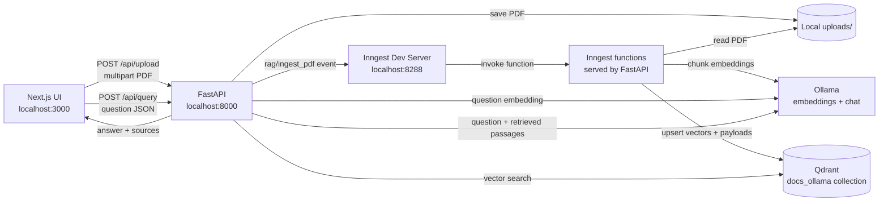
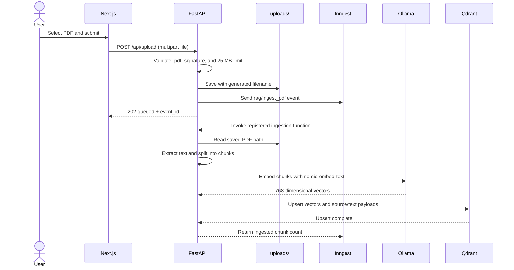
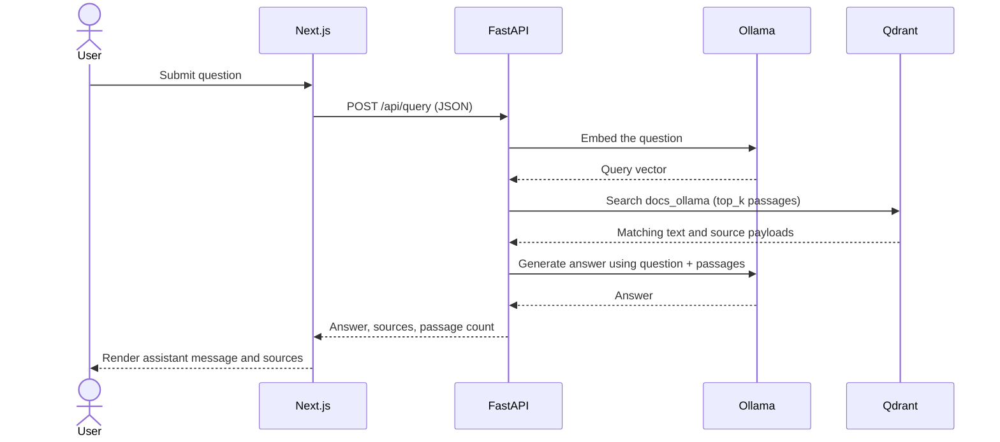

# Papertrail

> A local-first RAG workspace for uploading PDFs and asking questions grounded
> in their contents.

Papertrail combines a **Next.js chat UI**, **FastAPI**, **Inngest**, **Ollama**,
and **Qdrant**. PDF ingestion runs as a durable Inngest workflow; questions are
answered synchronously by retrieving relevant passages and asking a local
Ollama chat model to answer from them.

**Privacy by design:** in the default setup, embeddings and chat generation run
on your machine. PDF text and vectors are stored in your local services. This
project does not need an OpenAI API key.

> [!IMPORTANT]
> This is a local-development project, not a production-hardened multi-user
> service. The API has no authentication. Do not expose it or the Inngest,
> Qdrant, or Ollama development services to an untrusted network.

## Contents

- [Product tour](#product-tour)
- [Architecture](#architecture)
- [Workflows](#workflows)
- [Requirements](#requirements)
- [Quick start](#quick-start)
- [Configuration](#configuration)
- [API reference](#api-reference)
- [End-to-end walkthrough](#end-to-end-walkthrough)
- [Troubleshooting](#troubleshooting)
- [Current behavior and limitations](#current-behavior-and-limitations)
- [Project map](#project-map)

## Product tour

| Capability | What happens |
| --- | --- |
| Upload a PDF | FastAPI validates and stores the file, then queues an Inngest event. |
| Ingest in the background | Inngest extracts PDF text, chunks it, gets Ollama embeddings, and writes to Qdrant. |
| Ask a question | FastAPI embeds the question, retrieves matching chunks, and asks Ollama to answer from them. |
| Review evidence | The chat displays the source filenames returned with the answer. |

The upload confirmation means **queued**, not **indexed**. Check the Inngest
run before asking about a newly uploaded document.

## Architecture



### Component responsibilities

<details>
<summary><strong>Frontend — Next.js and React</strong></summary>

The browser UI lives in [`frontend/src/app/page.tsx`](./frontend/src/app/page.tsx).
It handles file selection, upload feedback, chat messages, loading indicators,
and source labels. It calls FastAPI directly using `fetch`; there is no separate
Next.js API proxy.

</details>

<details>
<summary><strong>API and workflow — FastAPI and Inngest</strong></summary>

[`main.py`](./main.py) defines the HTTP API and the Inngest functions.
FastAPI validates requests and coordinates calls to Ollama and Qdrant.
Inngest runs PDF ingestion as named, durable steps.

</details>

<details>
<summary><strong>AI and retrieval — Ollama and Qdrant</strong></summary>

[`data_loader.py`](./data_loader.py) extracts PDF text, splits it into
overlapping chunks, and calls Ollama's OpenAI-compatible local API for
embeddings. [`vector_db.py`](./vector_db.py) creates the Qdrant collection,
stores chunk payloads, and retrieves the nearest passages.

The `openai` Python package is used as a compatible HTTP client pointed at
Ollama's local URL. It does **not** mean requests go to OpenAI.

</details>

## Workflows

### PDF ingestion — asynchronous



The development Inngest server is available at
[`http://localhost:8288`](http://localhost:8288). Use its **Runs** view to
confirm ingestion has completed successfully.

### Ask a question — synchronous



The chat request stays open while search and generation run. A first request
can take longer while Ollama loads a model into memory.

## Requirements

Install or have access to:

| Requirement | Purpose |
| --- | --- |
| Python **3.14** and [`uv`](https://docs.astral.sh/uv/) | FastAPI, ingestion, and API dependencies |
| Node.js and npm | Next.js development server and frontend packages |
| [Ollama](https://ollama.com/) | Local embedding and chat inference |
| Docker (recommended) or another Qdrant deployment | Vector storage and similarity search |
| [Inngest CLI](https://www.inngest.com/docs/local-development) | Local event dispatch and workflow inspection |

The configured models are `nomic-embed-text` for embeddings (768 dimensions)
and `llama3.2:3b` for chat. The embedding model and vector dimension must stay
aligned with the Qdrant collection.

## Quick start

### 1. Get the code and install dependencies

```bash
git clone https://github.com/<YOUR_USERNAME>/<YOUR_REPOSITORY>.git
cd <YOUR_REPOSITORY>

uv sync
cd frontend
npm ci
cd ..
```

`uv sync` creates the Python environment from `uv.lock`. `npm ci` installs the
frontend dependencies from `frontend/package-lock.json`.

### 2. Start Ollama and download models

Install and open Ollama, then run:

```bash
ollama pull nomic-embed-text
ollama pull llama3.2:3b
ollama list
```

Ollama's default API is `http://localhost:11434`; this project uses the
OpenAI-compatible route at `http://localhost:11434/v1`.

### 3. Start Qdrant

With Docker installed, from the project root:

```bash
docker run --name papertrail-qdrant \
  -p 6333:6333 \
  -v "$(pwd)/qdrant_storage:/qdrant/storage" \
  qdrant/qdrant
```

Qdrant's HTTP API should respond at `http://localhost:6333`. The mounted
`qdrant_storage/` directory persists local vector data and is intentionally
ignored by Git. If the named container already exists, start it with
`docker start papertrail-qdrant`.

### 4. Start the FastAPI backend

In a terminal at the project root:

```bash
uv run uvicorn main:app --reload
```

FastAPI serves the HTTP API and registers Inngest functions at
`http://localhost:8000/api/inngest`. Interactive API docs are at
[`http://localhost:8000/docs`](http://localhost:8000/docs).

### 5. Start Inngest

In a second terminal:

```bash
npx inngest-cli@latest dev -u http://127.0.0.1:8000/api/inngest --no-discovery
```

Open [`http://localhost:8288`](http://localhost:8288) to inspect functions and
workflow runs. Keep this process running for PDF ingestion.

### 6. Start the frontend

In a third terminal:

```bash
cd frontend
npm run dev
```

Open [`http://localhost:3000`](http://localhost:3000).

<details>
<summary><strong>Run commands at a glance</strong></summary>

Keep all services running in separate terminals:

| Service | Command | Local address |
| --- | --- | --- |
| Ollama | Start the Ollama app | `localhost:11434` |
| Qdrant | `docker run ... qdrant/qdrant` | `localhost:6333` |
| FastAPI | `uv run uvicorn main:app --reload` | `localhost:8000` |
| Inngest | `npx inngest-cli@latest dev -u http://127.0.0.1:8000/api/inngest --no-discovery` | `localhost:8288` |
| Next.js | `cd frontend && npm run dev` | `localhost:3000` |

</details>

## Configuration

Optional values can be placed in a root `.env` for Python settings and
`frontend/.env.local` for Next.js settings. Do not commit either local env
file. No API key is required for local Ollama; the literal `ollama` value used
by the client is a compatibility placeholder.

| Variable | Used by | Default | Description |
| --- | --- | --- | --- |
| `OLLAMA_BASE_URL` | Backend | `http://localhost:11434/v1` | Ollama OpenAI-compatible API base URL |
| `OLLAMA_CHAT_MODEL` | Backend | `llama3.2:3b` | Local chat model name |
| `PDF_UPLOAD_DIR` | Backend | `<project-root>/uploads` | Where uploaded PDFs are saved for ingestion |
| `FRONTEND_ORIGINS` | Backend | `http://localhost:3000,http://127.0.0.1:3000` | Comma-separated browser origins allowed by CORS |
| `NEXT_PUBLIC_API_BASE_URL` | Frontend | `http://localhost:8000` | FastAPI base URL called by the browser |

Example `frontend/.env.local` for a different backend address:

```dotenv
NEXT_PUBLIC_API_BASE_URL=http://localhost:8000
```

`NEXT_PUBLIC_` values are included in browser code; only put public URLs there,
never secrets.

## API reference

### `POST /api/upload`

Accepts `multipart/form-data` with a `file` field containing a PDF. The current
limit is 25 MiB. On success, the PDF is saved locally and an Inngest event
named `rag/ingest_pdf` is queued.

```bash
curl -X POST http://localhost:8000/api/upload \
  -F "file=@./path/to/document.pdf"
```

Example response (`202 Accepted`):

```json
{
  "event_id": "event-id-from-inngest",
  "filename": "document.pdf",
  "status": "queued"
}
```

This response does not imply the PDF is searchable yet. Confirm the Inngest run
is complete before querying.

### `POST /api/query`

Accepts a JSON question and optional number of passages (`top_k`, 1–20; default
5). The endpoint embeds the question, searches Qdrant, and generates an answer
with Ollama.

```bash
curl -X POST http://localhost:8000/api/query \
  -H "Content-Type: application/json" \
  -d '{"question":"What is this document about?","top_k":5}'
```

Example response (`200 OK`):

```json
{
  "answer": "The document describes ...",
  "sources": ["document.pdf"],
  "num_contexts": 3
}
```

If no indexed passages are found, the endpoint responds with `409 Conflict`.
Interactive request schemas are available at
[`http://localhost:8000/docs`](http://localhost:8000/docs).

## End-to-end walkthrough

1. Start Ollama, Qdrant, FastAPI, and Inngest; start Next.js in another
   terminal.
2. Visit [`http://localhost:3000`](http://localhost:3000) and choose a PDF.
3. Select **Add to library**. The UI confirms when the event is queued.
4. Open [`http://localhost:8288`](http://localhost:8288) and find the
   **RAG: Ingest PDF** run.
5. Wait for the run to complete. Its output includes the number of chunks
   ingested.
6. Return to the app and ask a question. The answer appears with the source
   filename(s) used during retrieval.

## Troubleshooting

<details>
<summary><strong>Upload is queued but no Inngest run appears</strong></summary>

Check that FastAPI is running and the Inngest CLI was started with:

```bash
npx inngest-cli@latest dev -u http://127.0.0.1:8000/api/inngest --no-discovery
```

Open `http://localhost:8288` and check that the `RAG: Ingest PDF` function is
registered. The Inngest process must stay running.

</details>

<details>
<summary><strong>Ingestion fails while reading the PDF path</strong></summary>

The event contains a path on the machine running FastAPI, and the Inngest
function reads that same local file. Ensure the upload directory is writable
and that FastAPI and the function worker share the same filesystem. A
multi-machine deployment needs shared object storage instead.

</details>

<details>
<summary><strong>Ollama returns 404 or says a model is missing</strong></summary>

Confirm Ollama is running, the base URL ends in `/v1`, and both model names
exist:

```bash
ollama list
ollama pull nomic-embed-text
ollama pull llama3.2:3b
```

Set `OLLAMA_BASE_URL` if Ollama is not at `http://localhost:11434/v1`, and
restart FastAPI after changing its environment.

</details>

<details>
<summary><strong>Qdrant connection refused or vector-size mismatch</strong></summary>

Confirm Qdrant is reachable at `http://localhost:6333`. This app uses the
`docs_ollama` collection and expects 768-dimensional vectors from
`nomic-embed-text`. If changing embedding models or dimensions, use a separate
collection or recreate the collection and re-ingest documents; vectors from
different embedding models cannot be mixed for meaningful search.

</details>

<details>
<summary><strong>Browser reports a CORS error</strong></summary>

Set `FRONTEND_ORIGINS` in the backend environment to include the exact frontend
origin, for example:

```dotenv
FRONTEND_ORIGINS=http://localhost:3000,http://127.0.0.1:3000
```

Restart FastAPI after changing it. The origin must match the browser URL,
including hostname and port.

</details>

<details>
<summary><strong>Question says no indexed PDF content was found</strong></summary>

Wait for the upload's Inngest run to finish, then try again. Confirm the PDF
produced chunks and the run's embed/upsert step succeeded. Queries search the
shared `docs_ollama` collection.

</details>

## Current behavior and limitations

- Ingestion is asynchronous; the upload response confirms queuing only. There
  is not yet a frontend ingestion-status poller or per-document ready state.
- Chat questions are synchronous HTTP requests and can take as long as local
  model inference.
- Retrieval searches the whole `docs_ollama` collection; the UI does not yet
  scope a conversation to one selected PDF.
- The source identifier is the original filename. Uploading different PDFs
  with the same filename treats them as the same source identity for chunk
  IDs.
- Uploaded PDFs and Qdrant data are local runtime data, not Git-tracked
  application assets. Back them up separately if they matter.
- There is no authentication or user isolation. The default CORS allowlist is
  for local development.
- Ollama models run locally, but model downloads require internet access. Local
  inference uses your machine's memory and compute resources.

## Project map

| Path | Responsibility |
| --- | --- |
| [`main.py`](./main.py) | FastAPI routes, Inngest functions, search, and answer generation |
| [`data_loader.py`](./data_loader.py) | PDF text extraction, chunking, Ollama model configuration, and embeddings |
| [`vector_db.py`](./vector_db.py) | Qdrant collection creation, upsert, and similarity search |
| [`custom_types.py`](./custom_types.py) | Pydantic request/result data models |
| [`frontend/src/app/page.tsx`](./frontend/src/app/page.tsx) | PDF upload UI and chat interaction |
| [`frontend/src/app/globals.css`](./frontend/src/app/globals.css) | Responsive frontend styling |
| [`pyproject.toml`](./pyproject.toml) and [`uv.lock`](./uv.lock) | Python dependencies and lockfile |
| [`frontend/package.json`](./frontend/package.json) and [`frontend/package-lock.json`](./frontend/package-lock.json) | Frontend scripts, dependencies, and lockfile |

## License

No license file is currently included. Add a `LICENSE` file before redistributing
the project if you want to grant others explicit reuse rights.
